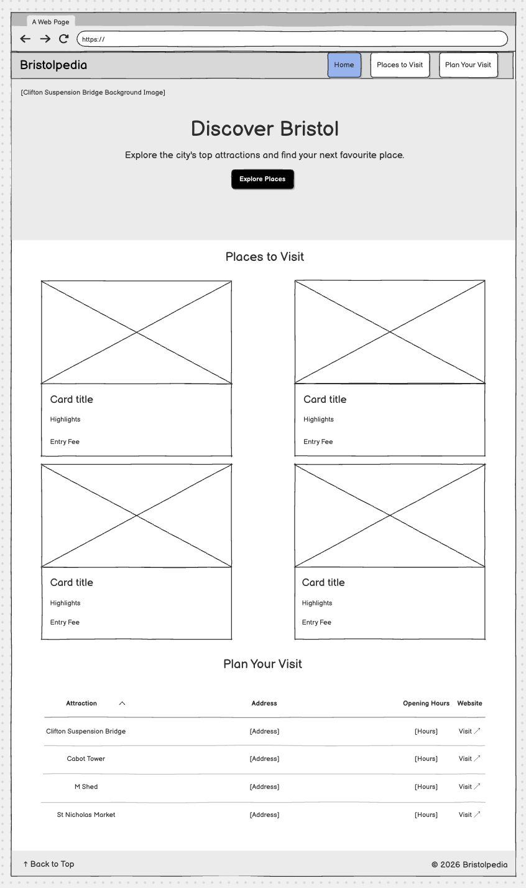
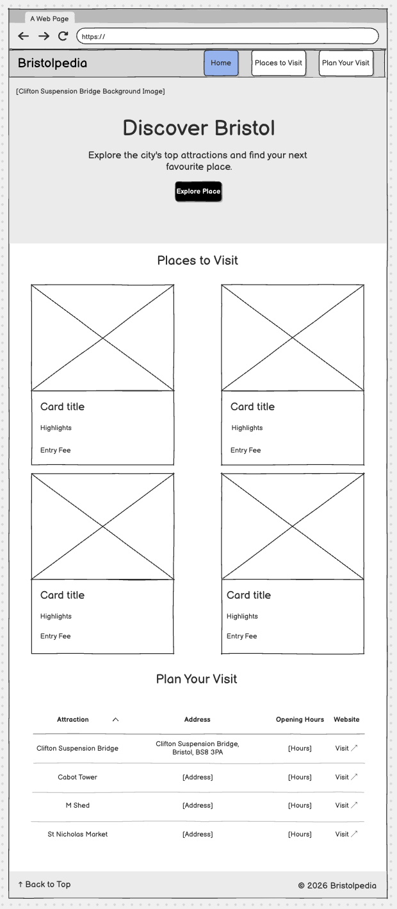
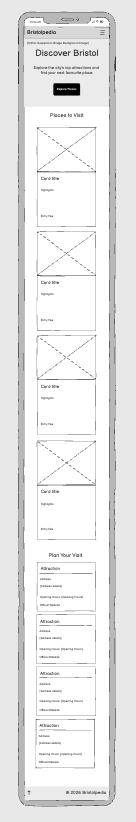

## Project Overview

Bristolpedia is a simple website that helps visitors explore the city of Bristol in the UK.

The website is designed for tourists and people who want to discover interesting places in Bristol.

Visitors can find information about four popular attractions, including photos, short descriptions, entry fees, opening hours and addresses.

The website is easy to use and works on mobile phones, tablets and desktop computers.

## User Experience (UX)

### Target Audience

Bristolpedia is designed for:

- Tourists who are visiting Bristol for the first time.
- People who want to discover popular attractions in Bristol.
- Visitors who want to plan their trip before travelling.

### User Goals

Visitors should be able to:

- Find interesting places to visit in Bristol.
- See photos and short descriptions of each attraction.
- Check entry fees and opening hours.
- Find addresses and links to official websites.
- Use the website easily on mobile phones, tablets and desktop computers.

### Design Choices

The website has a simple layout with clear navigation.

I used a combination of dark teal, gold and light colours to create a clean and welcoming design.

Attraction cards make the information easy to read, and the responsive layout helps visitors use the website on different screen sizes.

## User Stories & MoSCoW

I used the MoSCoW method to decide which features were most important for Bristolpedia.

### Must Have (Completed)

**1. Explore Places to Visit**

As a visitor, I want to explore places to visit, so that I can decide where I should go.

- Four attractions with photos and descriptions.
- Responsive attraction cards.

**2. View Attraction Opening Hours**

As a visitor, I want to see the opening hours, so that I can plan my visit.

- Opening hours for all four attractions.
- Links to official websites.

**3. View Attraction Entry Fees**

As a visitor, I want to see the entry fees, so that I can decide which places I can afford to visit.

- Entry fees displayed for every attraction.
- Free attractions clearly marked.

### Should Have (Not Implemented)

The following features were planned but not completed because of time limits:

- **Directions to attractions:** Help visitors find walking routes or public transport options.
- **Attraction facilities:** Show information about toilets, parking and accessibility.
- **Last checked dates:** Show when opening hours and entry fees were last checked.

These features may be added in a future version of the website.

### Project Management

I used GitHub Projects to record user stories, organise tasks and track their final status.

[View GitHub Project Board](https://github.com/users/SalarFarahani/projects/4)

## Wireframes

Before building Bristolpedia, I created wireframes to plan the layout and structure of the website.

I designed three wireframes for desktop, tablet and mobile screens.

The wireframes helped me plan the navigation, hero section, attraction cards and visitor information.

The final website follows the main structure of these wireframes, with some small design changes during development.

### Desktop Wireframe

### Tablet Wireframe

### Mobile Wireframe

### Changes from the Original Wireframes

During development, I made some changes to the original wireframes to improve the design and user experience.

These changes included updating the colour scheme, adjusting spacing and improving the layout for different screen sizes.

The main structure and purpose of the website remained the same.

## Features

### Navigation Bar

The website has a responsive navigation bar with links to the main sections.

On smaller screens, the navigation changes to a hamburger menu.

The navigation bar stays at the top of the page when visitors scroll down.

### Hero Section

The homepage has a large background image of Clifton Suspension Bridge.

It includes a welcome message and an "Explore Places" button that takes visitors to the attractions section.

### Places to Visit

This section shows four popular attractions in Bristol:

- Clifton Suspension Bridge
- Cabot Tower
- M Shed
- St Nicholas Market

Each attraction has a photo, a short description and entry fee information.

The cards are arranged in a responsive layout for different screen sizes.

### Plan Your Visit

This section helps visitors plan their trip.

It includes the address, opening hours and official website link for each attraction.

On desktop screens, the information is displayed in a table. On smaller screens, it changes to a card-style layout to make the information easier to read.

### Footer

The footer includes the website name, copyright information and a "Back to Top" link.

### Responsive Design

Bristolpedia is designed to work on mobile phones, tablets and desktop computers.

I used Bootstrap and custom CSS to create a responsive layout and improve the user experience.

## Technologies Used

### Languages

- **HTML5:** Used to create the structure and content of the website.
- **CSS3:** Used to style the website, including colours, fonts, spacing and responsive layouts.

### Frameworks and Libraries

- **Bootstrap 5.3.8:** Used for the responsive grid, navigation bar, cards and other layout components.
- **Font Awesome:** Used to add an icon to the "Back to Top" link.
- **Google Fonts:** Used to add Playfair Display for headings and Lato for body text.

### Tools

- **Visual Studio Code:** Used to write and edit the code.
- **Git:** Used to track changes during development.
- **GitHub:** Used to store the project and manage version control.
- **GitHub Projects:** Used to organise user stories and track tasks.
- **GitHub Pages:** Used to publish the website online.
- **W3C Markup Validation Service:** Used to check HTML code.
- **W3C CSS Validation Service:** Used to check CSS code.
- **Chrome Developer Tools:** Used to test the responsive design on different screen sizes.

## Testing

I tested Bristolpedia to make sure the website works correctly on different devices.

### HTML and CSS Validation

- **HTML:** Tested with W3C HTML Validator. No errors or warnings.
- **CSS:** Tested with W3C CSS Validator. No errors.

### Responsive Testing

I used Chrome Developer Tools to test the website.

| Device | Width | Result |
| --- | --- | --- |
| Mobile | 375px | Pass |
| Tablet | 768px | Pass |
| Desktop | 1440px | Pass |

The website displayed correctly on all three screen sizes.

### Functional Testing

I tested the following features:

- Navigation links: Pass
- Explore Places button: Pass
- Mobile menu: Pass
- External website links: Pass
- Back to Top link: Pass
- Responsive attraction cards and table: Pass

### Bugs Fixed

- Fixed navigation spacing.
- Improved the mobile table layout.
- Fixed the Cabot Tower website link.

### Known Limitations

- The mobile menu does not close automatically after selecting a link.
- Opening hours and prices may change. Visitors should check official websites before visiting.

## Deployment

I used GitHub Pages to publish Bristolpedia online.

### How I Deployed the Website

1. I pushed my project files to GitHub.
2. I opened the repository settings.
3. I selected **Pages** from the menu.
4. Under **Build and deployment**, I selected **Deploy from a branch**.
5. I selected the **main** branch and **/(root)** folder.
6. I clicked **Save**.

The website is now live and available to everyone.

### Live Website

[Bristolpedia](https://salarfarahani.github.io/bristolpedia/)

### GitHub Repository

[Bristolpedia GitHub Repository](https://github.com/SalarFarahani/bristolpedia)

## Credits

### Images

The images were taken from Unsplash, Tagvenue and Bristol Post.

- **Hero background (Clifton Suspension Bridge):** Photo by [Nathan Riley](https://unsplash.com/@nrly) on [Unsplash](https://unsplash.com/photos/hot-air-balloons-flying-above-trees-iOMkcADNoq8).
- **Clifton Suspension Bridge attraction image:** Photo by [Arthur Osipyan](https://unsplash.com/@arty_nyc) on [Unsplash](https://unsplash.com/photos/gray-concrete-dock-bridge-during-day-time-SVtWbDB4oxM).
- **Cabot Tower image:** Photo by [Baguette Knight](https://unsplash.com/@baguette_knight) on [Unsplash](https://unsplash.com/photos/a-tall-tower-with-a-clock-on-the-top-of-it-dLC_T3IFXTQ).
- **M Shed image:** Image from [Tagvenue - M Shed](https://www.tagvenue.com/venues/bristol/6112/m-shed#mosaic-gallery). Photographer unknown.
- **St Nicholas Market image:** Image from [Bristol Post](https://www.bristolpost.co.uk/whats-on/whats-on-news/look-back-fascinating-history-st-2028855). Photographer unknown.
- **Plan Your Visit background (Bristol Harbourside):** Photo by [Raúl Cacho Oses](https://unsplash.com/@raulcachophoto) on [Unsplash](https://unsplash.com/photos/three-commuter-bikes-parked-beside-harbor-erTULgoNt8g).

### Fonts

- [Google Fonts](https://fonts.google.com/) - Playfair Display and Lato.

### Libraries

- [Bootstrap](https://getbootstrap.com/) - Responsive layout and components.
- [Font Awesome](https://fontawesome.com/) - Back to Top icon.

### Information

Information about attractions was collected from their official websites.

### Acknowledgements

I used the Code Institute learning materials and the Boardwalk Games walkthrough to help me understand HTML, CSS, Bootstrap and responsive design.

## Future Features

Due to time limits, I focused on completing the most important features of Bristolpedia.

In the future, I would like to add:

- **Directions:** Information about how to get to each attraction.
- **Facilities:** Details about toilets, parking and accessibility.
- **Last Checked Dates:** Dates showing when opening hours and entry fees were last updated.

These features are listed as Should Have tasks in my GitHub Project board and may be added in a future version.
